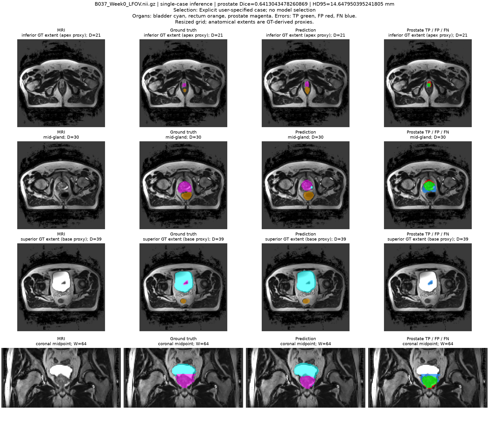

# Completed isolated inference profiles and direct 3D prediction

Job **717015**, 2026-10-30 05:50:07–05:52:22 AEST, NVIDIA A100-PCIE-40GB.
Both completion markers exist and the error log is empty. No training was run.
The public download archive SHA256 was
`8ac791f8fe40d97c6aa08d2700cded08cd3349e0b97418ccead24728bd9f7fe3`.
This folder retains original JSON/CSV/logs and the rendered example; checkpoint
weights, input MRI and voxel prediction arrays are not included in this upload.

| Model | Precision | Parameters | Forward ms/case | Prediction ms/case | Peak allocated / reserved GiB |
| --- | --- | ---: | ---: | ---: | ---: |
| 2D U-Net | FP32 | 1,942,374 | 18.63 | 21.75 | 0.2710 / 0.3418 |
| 3D U-Net | FP32 | 351,206 | 17.05 | 18.24 | 0.1815 / 0.2402 |
| 3D U-Net | BF16 | 351,206 | 9.75 | 10.91 | 0.1246 / 0.1582 |

All times are medians over 27 per-case medians (three repetitions after three
whole-case warmups). One model was resident on GPU at a time, starting with
zero other PyTorch allocations; TF32 was disabled. A 2D case comprises all 60
native slices in batches of 16; 3D uses one full 64×128×128 volume. Forward
excludes transfers; prediction includes transfers, argmax and output copy.
Both exclude disk loading, preprocessing and initial model loading. Memory is
PyTorch peak allocated/reserved, including weights and inference tensors/cache,
excluding driver/context and training. The inputs, model capacities and training
are different, so this measures these pipelines rather than dimension alone.

Raw [summary](summary.json), [81 per-case measurements](per_case_profile.csv),
[stdout](resource_717015.out), [stderr](resource_717015.err), and
[measurement protocol](../../../../UNet3D_s4984160/support/docs/resource_profile.md).
`python -m support.prepare_comparison` in the 3D directory verifies aggregates,
cohort identities, checkpoint hashes and direct-example counts against archives,
then updates the report and machine-readable resource table.

## Directly loaded 3D prediction

The new `predict.py --checkpoint ... --mri ... --mask ...` entry point loaded
the frozen refinement-epoch-11 checkpoint and actually ran BF16 GPU inference.
This was not cached rendering. B037 Week0 yielded prostate Dice **0.64130435**,
HD95 **14.64795040 mm** and predicted/GT volume **0.60096010**. All six classes'
TP/FP/FN and voxel totals match the original independent evaluation. This is the
previously retained failure case, not a replacement for the 27-case mean.

The image shows undercoverage at the middle and missed superior prostate extent.
GT-derived extent planes are proxies, not clinical apex/base annotations.
The mask supplies metrics/overlays only and is not fed to the model.

[Direct inference metadata](predict_demo/summary.json) and
[completion marker](predict_demo/prediction_complete.txt).

