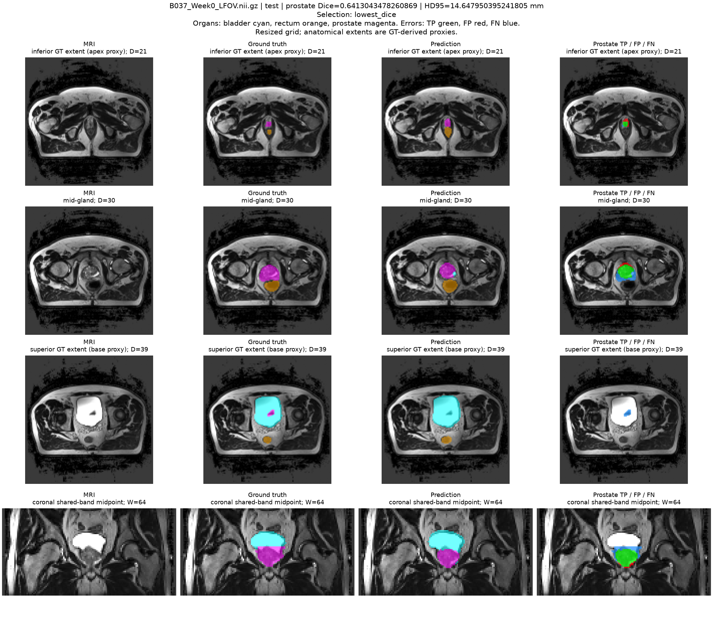
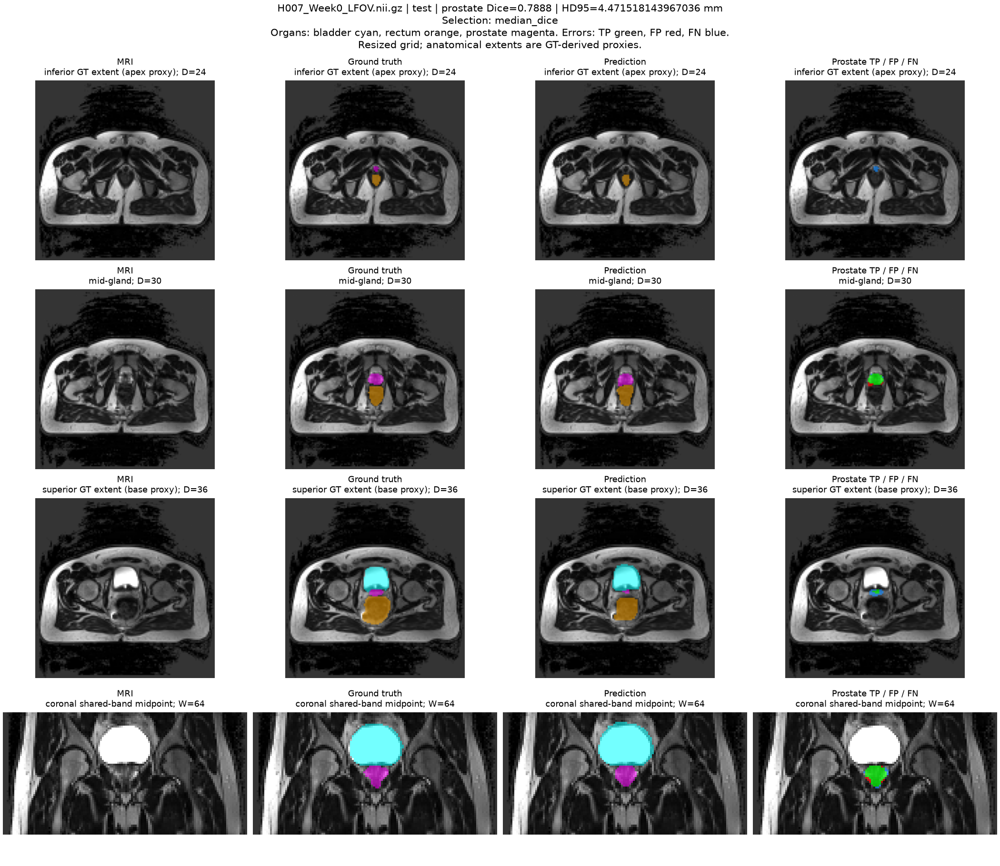

# 3D U-Net：五个预测案例的观察与核对

核对日期：2026-10-30。材料为已冻结模型的五张测试预测 PNG、
`per_case_metrics.csv`、`boundary_extent_metrics.csv` 和原始绘图/选例代码。
没有重新训练、修改预测或挑选新病例。下文为算法错误分析，不是独立临床标注审查。

## 如何读图与数据

每图四列为 MRI、GT、预测、前列腺误差；误差图绿色为 TP、红色为 FP、
蓝色为 FN。器官叠加颜色为膀胱青色、直肠橙色、前列腺品红色。
前三行是 GT 前列腺最下端、中部、最上端的轴向切片，最后一行是固定冠状面。
这些视图只展示部分切片，不足以证明体积其他位置不存在错误或孤立小岛。

图中 Dice、HD95 是**完整降采样体积**的指标，不是当前单张切片的指标。
边缘 CSV 则合并 GT 首末各两层；例如图显示 D=39，表中的上端指标来自 D=38,39。
二者覆盖不同，不能把两层 FN 数量说成图中那一层的像素数。
体素计数在 64×128×128 网格上，HD95 使用近似调整后的 mm 间距。
inferior/superior extent 是 GT 端部代理区域，不能直接当作已确认的临床 apex/base。

五例来自预先确定的不同错误类别，并优先选不同患者。因此标签
`highest_hd95`、`largest_missed_fraction` 表示当前选例策略，不保证该病例是全体
测试扫描中这个指标最差者；例如 B037 的 HD95 实际高于 L011。
K042 是较好整体分割中仍存在端部漏分的例子，H007 是中间分数附近的例子。

## 汇总表

| 病例 | Dice | HD95（约 mm） | 预测/GT 体积比 | 精确率 | 召回率 | 误入膀胱/直肠体素 |
| --- | ---: | ---: | ---: | ---: | ---: | ---: |
| B037 Week0 | 0.6413 | 14.65 | 0.6010 | 0.8542 | 0.5134 | 0 / 0 |
| L011 Week2 | 0.7088 | 8.13 | 1.6787 | 0.5655 | 0.9493 | 32 / 0 |
| H017 Week3 | 0.7215 | 6.72 | 0.9916 | 0.7246 | 0.7185 | 10 / 0 |
| K042 Week0 | 0.8525 | 6.26 | 0.9017 | 0.8990 | 0.8106 | 0 / 0 |
| H007 Week0 | 0.7888 | 4.47 | 1.0833 | 0.7585 | 0.8217 | 0 / 5 |

可机器核对的选例、完整指标、上下端两层指标和 PNG SHA256 在
[`case_review_metrics.csv`](experiment_notes/final_test_refine_v2/case_review_metrics.csv)。
其数值来自原始 CSV；PNG 标题中的病例、Dice 和 HD95 也已逐张对照。

## 1. B037 Week0：整体欠分割，上端完全漏分

**图像观察：** 中部 D=30 仍有较大的绿色重叠，但 GT 一侧有明显蓝色漏分。
上端 D=39 的 GT 品红色小区域没有相应前列腺预测，误差图显示蓝色；冠状面也可见
GT 与预测上端覆盖不一致。下端 D=21 则存在绿色重叠和局部红色外扩。

**数据核对：** GT 3333、预测 2003 个体素，体积比 0.6010；FN 1622，召回率
0.5134。上端 D=38,39 的 GT 共 87 个体素，预测为 0，区域 Dice=0。
下端两层 Dice=0.6804，说明它也不是所有位置都单纯缩小。膀胱和直肠侵入计数均为零，
不能把这个失败解释为主要侵入这两个器官。

**可支持的结论：** 整体欠覆盖，尤其 GT 上端的漏分，和较低 Dice、较大 HD95 相符。
GT 在该区域的形态、降采样及邻近组织区分可能影响结果，但截图不能证明这些是原因，
也不能据此判定 GT 错误。

## 2. L011 Week2：高召回伴随多分，局部边缘仍漏分

**图像观察：** 中部 D=38 的绿色区域周围存在红色边缘，显示预测超出 GT；
上端 D=44 的微小 GT 区域存在蓝色漏分。冠状面中心大部分匹配，但不能因此推断
整个体积没有过分割。

**数据核对：** 预测 1259、GT 750 个体素，体积比 1.6787；精确率 0.5655、
召回率 0.9493，FP 547、FN 38。预测前列腺有 32 个体素落在 GT 膀胱内。
上端两层 D=43,44 中 TP=3、FP=47、FN=19，Dice 仅 0.0833。
该两层汇总包含多分和漏分，并非只漏分；这不与单张 D=44 显示蓝色相矛盾。

**可支持的结论：** 这是总体高召回、低精确率的过分割例，同时有局部端部定位问题。
体积偏大不能等同于所有边缘都覆盖正确。它不是整组 HD95 最大病例，选例优先不同患者。

## 3. H017 Week3：总体积几乎正确，但空间匹配仍不足

**图像观察：** 中部 D=33 同时存在红色和蓝色边缘；上端 D=37 也有绿色重叠与
局部漏分。冠状面大部分为绿色，边缘仍有红蓝差异，提示总体积相近并不等于边界一致。

**数据核对：** 预测 472、GT 476 个体素，体积比 0.9916，却仍有 FP 130、FN 134，
Dice 0.7215。10 个预测前列腺体素落在 GT 膀胱内，直肠内为零。
这个侵入计数覆盖整个体积；不能把当前四个视图中的所有红色都称为膀胱侵入。

**可支持的结论：** 体积误差的正负抵消会掩盖位置或轮廓不匹配，所以必须联合看
Dice、HD95 和误差叠图。可以描述局部轮廓不一致，不能仅凭这些面认定整个器官发生
刚性位移，或认为已找到了造成混淆的具体影像因素。

## 4. K042 Week0：整体较好，GT 下端仍明显漏分

**图像观察：** 中部 D=34 与冠状面大部分绿色重叠，属于五例中整体 Dice 较好的例子。
下端 D=26 出现蓝色漏分，上端 D=41 仍有局部红色外扩。

**数据核对：** 完整体积 Dice 0.8525、精确率 0.8990、体积比 0.9017。
下端两层 D=26,27 的 TP=31、FN=37，召回率仅 0.4559、Dice 0.5688。
上端两层的体积比为 1.2596，说明全体积偏小仍可以同时伴随上端局部偏大。

**可支持的结论：** 整体分数较高仍可能掩盖小体积端部错误；较大的主体对 Dice
贡献更多。它用于展示“成功主体＋局部失败”，不能把选例名称误写为测试集漏分最严重。

## 5. H007 Week0：中间水平整体表现，端部小区域漏分

**图像观察：** 中部 D=30 多数为绿色并有少量红色边缘；下端 D=24 的小 GT 区域
没有相应预测，显示蓝色；上端 D=36 亦可见蓝色漏分。冠状面主体大致重叠。

**数据核对：** 完整体积 Dice 0.7888、体积比 1.0833。下端两层 D=24,25
GT 28 个体素，TP 仅 3，召回率 0.1071、Dice 0.1714；上端两层 Dice 0.6525。
预测前列腺有 5 个体素落在 GT 直肠内，其余体积 FP 不能因此都归为直肠侵入。

**可支持的结论：** 这不是只发生在最差病例中的问题：整体达到 0.70，仍可能丢掉
很小的 GT 端部。固定冠状面看起来良好也不能替代其他层面的检查。

## 共同结论与报告中的工程建议

五例支持三种不同失败模式：B037 的明显欠覆盖、L011 的过分割，以及 H017 的
体积接近但轮廓不匹配。K042 和 H007 进一步表明，整体 Dice 达标不能保证端部完整。
因此最终报告应同时给出总体分数、逐病例差异、体积比例和端部错误，不只展示主体匹配。

降采样可能让小端部更难保留，局部对比度或相邻组织混淆也值得检查，但本实验没有
原分辨率消融、对比度测量或独立临床地标，不能把这些假设写成已确认的根因。
没有在这些测试结果上再训练或调阈值；后续改进应另行使用训练/验证数据验证。

作为工程原型，可建议把端部缺失、明显体积异常和邻近器官边界作为人工复核重点；
本实验没有校准自动放行阈值，也不支持不经复核直接用于临床勾画。
没有做连通分量审计，不能声称已排除小孤立预测。

## 核对记录

- 五张 PNG 的病例 ID、Dice、HD95 与对应完整体积 CSV 行一致。
- 用原始 TP/FP/FN 重算选中五例的 Dice，与归档分数一致。
- 按原始 `select_examples` 逻辑重算，得到相同五例及顺序。
- 上下端两层的索引和数字与 `boundary_extent_metrics.csv` 对应。
- 图像颜色与 `predict.py` 的颜色表一致；没有改图或编辑预测。
- 这些是对既有图和记录的检查；没有重新读取全部原始 MRI/预测体积，也没有独立验证
  所有层面的空间标注正确性。
