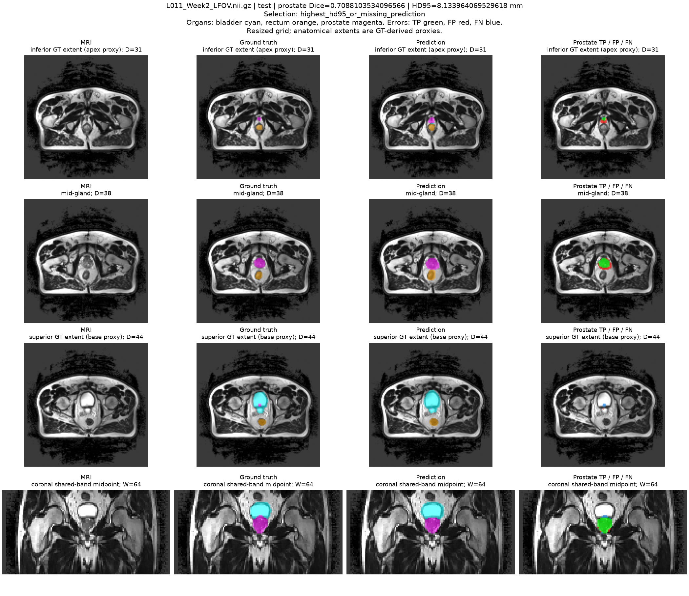
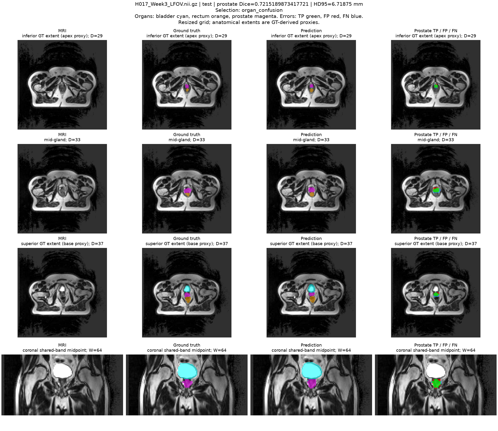
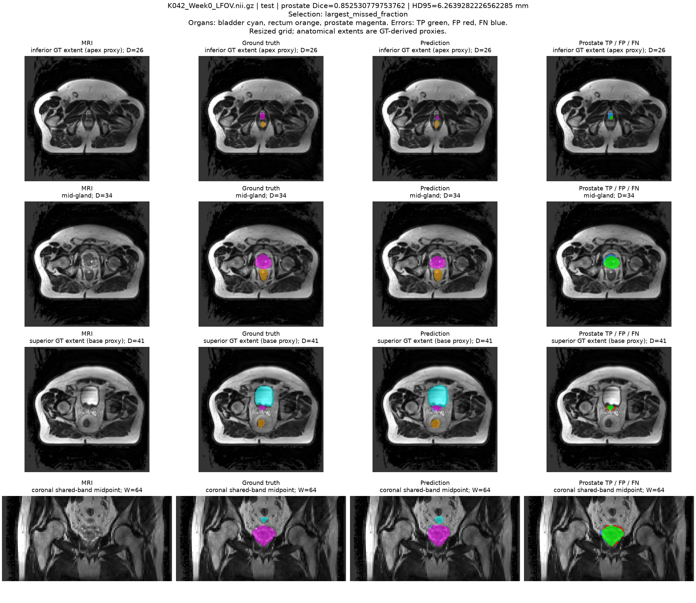

# Standard 3D U-Net (Normal difficulty)

Final held-out test prostate mean scan Dice: **0.773216** on 27 scans from six
patients. Validation-selected Dice: **0.755972**. This README is the project's
report entry point, including comparison tables and the five illustrated cases.

## Folder guide

```text
UNet3D_s4984160/
  README.md                 Main report and comparison tables
  dataset.py                Data pairing, patient split and preprocessing
  modules.py                Standard 3D U-Net components
  baseline_model.py         Checkpoint-configured normalization factory
  train.py                  Final refinement stage (actual selected model)
  evaluate.py               Frozen-checkpoint evaluation
  predict.py                Render saved predictions
  evaluation_utils.py       Metric and geometry definitions
  prepare_comparison.py     Verify archived scores and update report tables
  training/scratch.py       Initial from-scratch training stage
  scripts/                  Three current Slurm submission scripts
  tests/                    Synthetic evaluator checks
  docs/                     Detailed methods, case analysis and protocols
  artifacts/final_test_3d/   Original JSON/CSV and figures/
  comparison/               Machine-readable comparison JSON/CSV
  history/                  Distinct early work and source provenance
```

Code is stored once. Fifteen duplicate Python copies in the three former
snapshot folders were removed after content verification. The exact submitted
versions remain available in Git, recorded by
[history/source_snapshots.json](history/source_snapshots.json). Remote cluster
snapshots and already submitted jobs were not changed by this reorganization.
Local-only caches/notes under `_local/` and `results/` are excluded from Git.

## Current workflow and files

| Step | Current file | Role |
| --- | --- | --- |
| Prepare data | `dataset.py` | Pair NIfTI MRI/masks, split by patient, normalize, resize |
| Construct model | `modules.py` + `baseline_model.py` | Standard U-Net with recorded InstanceNorm configuration |
| Initial training | `training/scratch.py` | First 15 epochs of the recorded experiment |
| Refinement | `train.py` | New optimizer/loss weights, selected at refinement epoch 11 |
| Evaluate | `evaluate.py` + `evaluation_utils.py` | Frozen checkpoint, disjoint test cases, explicit metric definitions |
| Show predictions | `predict.py` | Plot cached inference arrays without repeating inference |
| Update comparison | `prepare_comparison.py` | Recheck archived counts and regenerate tables below |

The model uses base width 8 and affine InstanceNorm3d (351,206 parameters),
without residual blocks or deep supervision. `modules.py` defines the standard
components; `baseline_model.py` constructs the normalization actually trained.
The 211 scans from 38 patients were split into 145/39/27 scans from 26/6/6
patients. MRI nonzero voxels were normalized per volume, axes changed from
(X,Y,Z) to (Z,X,Y), and MRI/labels resized to 64×128×128 using trilinear/nearest.

Training combined 15 initial epochs with 11 refinement epochs. Sampling used
50% full volumes, 25% rectum-centred and 25% prostate-centred blocks; weights
were selected using validation prostate Dice, not the test set. The refinement
stage loaded the initial last checkpoint and reset its optimizer. It stopped
after three consecutive validation scores of at least 0.70. See
[detailed methods](docs/methods.md) for settings and validation history.

## Running the current layout

Requires Python, PyTorch, NumPy, NiBabel, SciPy and Matplotlib. The original
evaluation environment versions are recorded in
[summary.json](artifacts/final_test_3d/summary.json). Private course data and
weights are not included. Dataset default:
`/home/groups/comp3710/HipMRI_Study_open`.

From this project directory on the configured cluster:

```bash
sbatch scripts/train_scratch.sbatch
# After initial training finishes and its last checkpoint exists:
sbatch scripts/train_refine.sbatch
# After the selected refinement checkpoint exists:
sbatch scripts/evaluate.sbatch
```

Do not submit the dependent stages concurrently. The Slurm account, partition,
GPU and 1.5-hour requests are unchanged; only Python entry-point paths changed.
These examples are for a new run, not an instruction to restart the completed
experiment. Existing evaluation requires a fresh output directory; see
[evaluation usage](docs/evaluation.md).

Useful local commands, from this project directory:

```bash
python -m training.scratch --help
python train.py --help
python -m unittest discover -s tests -v
python prepare_comparison.py
```

The final checkpoint remains on the cluster at `results/refine_v2/best_model.pt`;
its SHA256 and original metrics are in
[the result record](artifacts/final_test_3d/README.md). Historical early code is
under `history/`, not the current training entry point. Additional references:
[case analysis in Chinese](docs/case_analysis.md),
[comparison protocol](docs/comparison_protocol.md), and
[2D/3D data mapping](docs/data_mapping.md).

The test mean exceeds 0.70, but **3 of 27 scans fall below it**. Pooled predicted
volume exceeds GT by 17.75%. Figures and their numerical records have been
reviewed as algorithmic error examples, not an independent clinical annotation
audit. The final aligned 2D comparison remains pending. Code/training/evaluation
and documentation used AI assistance; retain the full disclosure in the final
report.

<!-- BEGIN GENERATED COMPARISON -->
## Model comparison: complete volume and shared band

The tables below separate measured scopes. Pending is not a score of zero.
No 2D test result or 3D-versus-2D ranking is available yet. Improved 2D
U-Net is an optional unscheduled row, not an additional active experiment.

### A. Complete-volume 3D reference

| Model / scope | Test patients/scans | Mean scan Dice ± SD | Mean IoU | HD95 (approx. mm) | Pooled volume ratio |
| --- | ---: | ---: | ---: | ---: | ---: |
| Standard 3D U-Net; 64×128×128 full grid | 6 / 27 | 0.7732 ± 0.0557 | 0.6336 | 6.50 | 1.1775 |

This table supports the complete-volume 3D result. Native 2D partial-slice
results cannot be placed in this scope or used to claim a direct advantage.

### B. Shared-band prostate comparison (separate evaluation scope)

| Model | Test patients/scans | Mean scan Dice ± SD | Mean patient Dice | Pooled precision / recall | Pooled volume ratio | Shared HD95 / organ invasion |
| --- | ---: | ---: | ---: | ---: | ---: | --- |
| Standard 3D U-Net | 6 / 27 | 0.7732 ± 0.0557 | 0.7678 | 0.7147 / 0.8416 | 1.1775 | Not measured for this scope |
| Standard 2D U-Net | Required: same 6 / 27 | Pending | Pending | Pending | Pending | Pending |
| Improved 2D U-Net (optional; not scheduled) | Required: same 6 / 27 | Pending | Pending | Pending | Pending | Pending |

Shared grid: D=64, H=128, full-volume W indices 49..78 (30 planes).
These nearest-resized mask planes correspond to original axis-1 indices
98,100,...,156 within the supplied 60-slice band [98,157]. This differs
from scoring all 60 native-resolution 2D slices. Actual 2D predictions
must first be mapped to this grid and their GT checked for exact equality.

The full/shared 3D prostate counts happen to agree in this archived run.
That does not justify copying complete-volume HD95 or invasion counts
into the shared-band table. Those metrics require their own spatial
calculation. Labels on crop boundaries can affect surface distances.

### C. Six-class region check (3D only)

| Class | Full-volume mean scan Dice | Shared-band mean scan Dice |
| --- | ---: | ---: |
| Background | 0.9939 | 0.9742 |
| Body | 0.9708 | 0.9663 |
| Bones | 0.8748 | 0.8882 |
| Bladder | 0.9146 | 0.9212 |
| Rectum | 0.8197 | 0.8159 |
| Prostate | 0.7732 | 0.7732 |

### D. Paired-case template on the shared grid

| Test case | 3D shared-band prostate Dice | 2D shared-band Dice | Improved 2D (optional) |
| --- | ---: | --- | --- |
| B037_Week0 | 0.6413 | Pending | Pending |
| L011_Week2 | 0.7088 | Pending | Pending |
| H017_Week3 | 0.7215 | Pending | Pending |
| K042_Week0 | 0.8525 | Pending | Pending |
| H007_Week0 | 0.7888 | Pending | Pending |

Reuse these fixed case identities for the 2D overlays; include all 27
scans in numerical comparisons rather than evaluating only these examples.

### E. Resource profile (separate from accuracy scope)

| Model | Parameters | Precision / hardware | Forward latency | Peak inference allocation |
| --- | ---: | --- | --- | --- |
| Standard 3D U-Net | 351,206 | BF16 / NVIDIA A100-PCIE-40GB | 17.55 ms median per volume | 0.1364 GiB |
| Standard 2D U-Net | Pending checkpoint configuration verification | Pending measurement | Pending full-scan measurement | Pending |
| Improved 2D U-Net (optional) | Pending implementation | Pending | Pending | Pending |

The existing 3D timing uses the full input volume, excludes data loading,
transfer, argmax, metrics and plotting, and is not training memory/time.
A 2D per-slice time is not comparable with a 3D per-volume time. Report
complete-scan 2D timing and use matched hardware/precision for architecture
claims; otherwise label the hardware difference. Shared-band accuracy does
not mean the 3D network was run on a cropped input.

### F. Native-resolution 2D results (not the shared-grid comparison)

| Model / scope | Test patients/scans/slices | Mean scan prostate Dice | Mean IoU |
| --- | --- | --- | --- |
| Standard 2D U-Net; all 60 original unpadded slices per scan | Required: 6 / 27 / 1620 | Pending | Pending |
| Improved 2D U-Net (optional); same native band | Required: 6 / 27 / 1620 | Pending | Pending |

This is the native 2D task, grouped by scan. Its figures and metrics use
original valid pixels (256×128 or 256×144); padding label 255 is ignored.
These results are not substituted into table B without grid alignment.

Protocol and missing-result rules: [comparison protocol](docs/comparison_protocol.md).
Auditable tables: [comparison/metrics.json](comparison/metrics.json) and
[comparison/metrics.csv](comparison/metrics.csv). Regenerate with
`python prepare_comparison.py`; this only reads archived local records.
<!-- END GENERATED COMPARISON -->

## Qualitative error analysis: five held-out cases

These examples use the frozen checkpoint from the reported 3D test run. The
figure titles and metrics were checked against the archived full-volume CSV;
GT-derived boundary-region counts were checked separately. No training,
postprocessing or test-driven threshold selection was performed for this review.

Green/red/blue denote prostate TP/FP/FN. Cyan/orange/magenta denote bladder,
rectum/prostate in the organ overlays. The first three rows show one inferior
GT extent, middle and superior GT extent axial plane; the fourth shows a fixed
coronal plane. Full-volume metrics must not be interpreted as single-plane
metrics. Boundary CSV scores below pool the first/last two GT-bearing planes,
whereas each axial figure row shows one plane. Extents are proxies, not
independently annotated clinical apex/base landmarks. HD95 is approximate
millimetres in the resized grid; counts refer to that grid.

Selection was deterministic and favoured different patients. Strategy names
such as highest HD95 or largest missed fraction are selection priorities, not
claims that every selected case is a global worst case. K042 illustrates a
good overall result with local failure, and H007 illustrates a middle-score case.

| Case | Dice | HD95 (approx. mm) | Pred/GT ratio | Precision | Recall | FP in bladder/rectum |
| --- | ---: | ---: | ---: | ---: | ---: | ---: |
| B037_Week0 | 0.6413 | 14.65 | 0.6010 | 0.8542 | 0.5134 | 0 / 0 |
| L011_Week2 | 0.7088 | 8.13 | 1.6787 | 0.5655 | 0.9493 | 32 / 0 |
| H017_Week3 | 0.7215 | 6.72 | 0.9916 | 0.7246 | 0.7185 | 10 / 0 |
| K042_Week0 | 0.8525 | 6.26 | 0.9017 | 0.8990 | 0.8106 | 0 / 0 |
| H007_Week0 | 0.7888 | 4.47 | 1.0833 | 0.7585 | 0.8217 | 0 / 5 |

### B037 Week0: undersegmentation and missing superior extent


The middle axial plane (D=30) retains a matching core but shows a visible blue missed border. At D=39 the GT prostate region is missed; the coronal view also shows incomplete extent coverage. Whole-volume prediction contains 2,003 voxels against 3,333 GT voxels (ratio 0.6010), with 1,622 FN and recall 0.5134. In the superior two-plane region D=38,39, all 87 GT voxels are missed and regional Dice is zero. This supports undercoverage as the dominant failure, consistent with Dice 0.6413 and HD95 14.65 mm. Neither bladder nor rectum invasion explains it: both counts are zero.

### L011 Week2: oversegmentation with local boundary misses



A red rim surrounds the matching core at D=38, while the tiny GT region at D=44 has blue missed voxels. Whole-volume predicted volume is 1.6787 times GT, with precision 0.5655, recall 0.9493 and 547 FP. Of these FP, 32 overlap GT bladder. The superior two-plane region D=43,44 contains TP=3, FP=47 and FN=19 (Dice 0.0833), showing that high overall recall does not guarantee correct local boundaries. The red and blue errors coexist across the two-plane region; its counts do not describe only the displayed D=44 plane. This is not the global highest-HD95 scan: the selection favours a new patient after B037.

### H017 Week3: near-correct volume with spatial mismatch



The D=33 error map shows both red and blue border discrepancies despite a matching centre. Predicted and GT volumes are nearly equal (472 versus 476 voxels; ratio 0.9916), but FP=130 and FN=134 yield Dice 0.7215. Ten predicted prostate voxels overlap GT bladder across the entire volume; that count cannot be assigned to every visible red border. Volume agreement alone therefore hides contour or position errors. These views do not establish a rigid displacement or prove an imaging cause.

### K042 Week0: good overall overlap, incomplete inferior extent



The middle axial and coronal views show predominantly green overlap, consistent with the relatively high full-volume Dice of 0.8525. The inferior D=26 plane still has blue misses, while the superior view has local red extension. In D=26,27, TP=31 and FN=37 give regional recall 0.4559 and Dice 0.5688. The superior two-plane volume ratio is 1.2596 despite the whole-volume ratio being 0.9017. A high global Dice can therefore conceal errors in small extent regions and even opposite local volume biases.

### H007 Week0: a middle-score case with small-extent failure


The middle plane (D=30) and coronal view have a matching core, but the inferior D=24 GT focus is missed and the superior D=36 view also shows blue error. The overall Dice is 0.7888 with volume ratio 1.0833. Across D=24,25, only 3 of 28 GT voxels are recovered (recall 0.1071; Dice 0.1714). Superior two-plane Dice is 0.6525. Five predicted prostate voxels overlap GT rectum somewhere in the full volume; the remaining FP are not all rectal invasion. Thus extent omission persists beyond the worst-scoring scan.

### Interpretation and engineering recommendation

The cases distinguish undercoverage, excess volume, and offsetting FP/FN
with nearly correct volume. Good overlap in the gland core or a passing overall
Dice does not ensure accurate small extents. Downsampling and local tissue
ambiguity are possible contributors, but no resolution ablation, contrast
measurement or independent landmark annotation establishes them as root causes.
These test observations should motivate future validation experiments, not
tuning on the held-out test set.

For this prototype, manual review should concentrate on extent coverage,
large volume discrepancies and adjacent-organ borders. No automatic-release
policy or clinical acceptance threshold was calibrated. The four selected
planes do not inspect all voxels; no connected-component audit was performed,
so absence of small disconnected artifacts is not established.

The checked numerical evidence and PNG hashes are in
[`case_review_metrics.csv`](artifacts/final_test_3d/case_review_metrics.csv).
A more detailed Chinese explanation is in [CASE_ANALYSIS.md](docs/case_analysis.md).

## Final report assembly and submission status

Course specification v2.4, Sections 4, 4.1 and 5.3, requires the report in the
project-specific `README.md`, with a PDF export for Turnitin and a GitHub PR
against upstream `topic-recognition`. This file is the report entry point for
this project; the repository-root README is the shared course introduction.

This remains a report in progress. The complete method notes in
[EXPERIMENT_REPORT.md](docs/methods.md) should be consolidated into the
final report body, together with the original one-page feasibility review,
final aligned 2D/3D comparison, literature references and a complete subsection
entitled `Artificial Intelligence Usage Disclosure`. The current root `train.py` is the final refinement training stage. The
current `predict.py` renders cached predictions after `evaluate.py` performs
checkpoint loading/inference; the direct-inference entry-point requirement
still needs final review before submission. A README export should
include the actual report text and figures rather than rely solely on links.
No final PDF export or PR creation is claimed by this documentation update.
