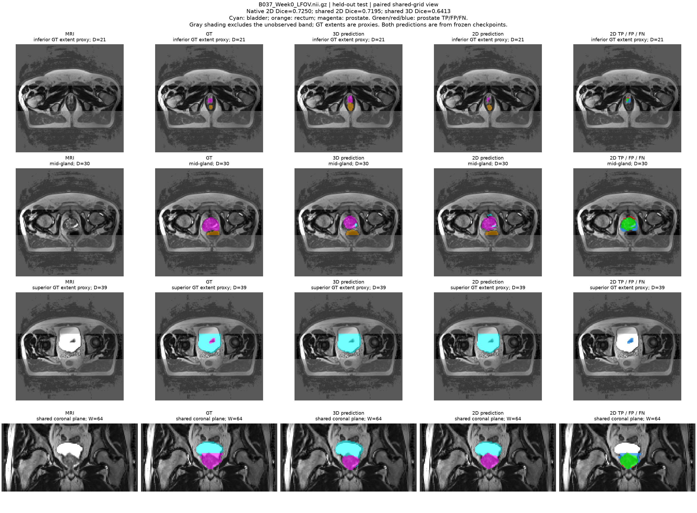
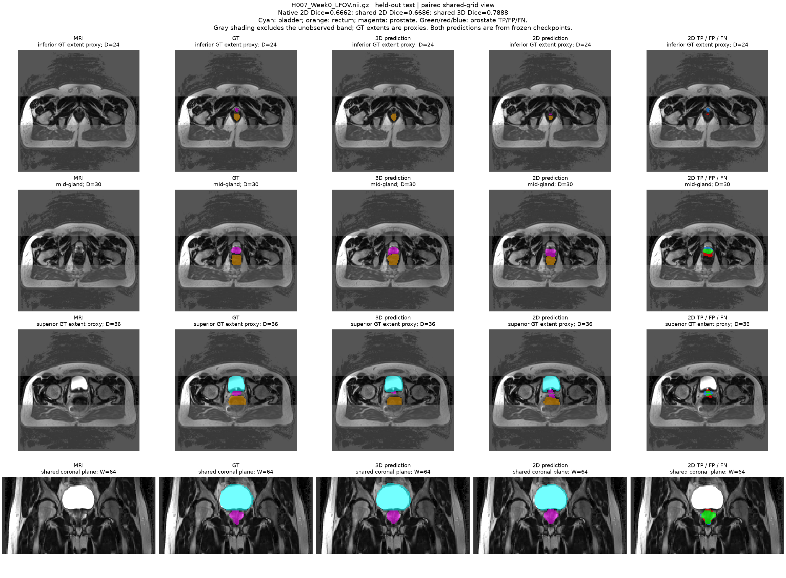

# Standard 3D U-Net for HipMRI Segmentation

COMP3710 · Normal difficulty · Student ID: s4984160 · Updated 30 October 2026

## 1. Project overview and working principles

### 1.1 Project purpose and segmentation task

The main objective is to build a reproducible 3D U-Net baseline for prostate
segmentation across the full MRI volume. An independently trained 2D U-Net
serves as a comparator, using the same patient groups for training, validation
and testing. The 2D data cover only part of each volume, so the two models are
compared within a verified common evaluation region.

This project uses the course HipMRI dataset for six-class MRI segmentation.
`dataset.py` loads and preprocesses the MRI data, while `modules.py` defines
the network architecture. The model classifies each voxel as Background, Body,
Bones, Bladder, Rectum or Prostate, corresponding to labels 0–5. `predict.py`
loads the trained model, generates predictions and visualizes the segmentation
results.

### 1.2 Working principles and model implementation

The 3D U-Net consists of an encoder, a bottleneck and a decoder [1,2]. The
encoder uses repeated convolutions and pooling to extract image features while
gradually reducing spatial resolution. The bottleneck processes these features
at the smallest spatial scale. The decoder then upsamples the features to
restore the input resolution. Skip connections bring features from corresponding
encoder layers into the decoder, helping it combine spatial detail with broader
context.

`modules.py` defines the 3D U-Net structure, while
`support/baseline_model.py` replaces `BatchNorm3d` with `InstanceNorm3d` to
ensure that training and prediction use the same network structure. The model
defined in `modules.py` has three pooling levels, with channel counts of 8,
16, 32 and 64. Its final convolution produces six class scores for each voxel.

During training, `train.py` compares the model output with the reference labels,
calculates the loss and updates the model weights through backpropagation.
During prediction, `predict.py` loads the saved weights, runs the MRI through
the model and selects the highest-scoring class as the predicted label for each
voxel. Reference labels are used only to evaluate and display the results, not
as input to the model.

```text
MRI input
   ↓
Encoder
Convolutions extract features;
pooling gradually reduces spatial size
   ↓
Bottleneck
Processes features at the smallest spatial size
   ↓
Decoder ← Encoder features passed through skip connections
Upsampling gradually restores spatial size
and combines features from the encoder
   ↓
Output layer
Produces six class scores for each voxel
   ↓
Select the highest-scoring class
   ↓
Segmentation map
Each voxel receives a class label (0–5)
```

The encoder, bottleneck, decoder and output layer are defined in `modules.py`.
`predict.py` selects the highest-scoring class for each voxel and visualizes
the segmentation results.

## 2. Feasibility review and final scope

### 2.1 Original plan and acceptance criteria

The prototype was intended to assist imaging specialists reviewing anatomical
contours. The original feasibility review proposed a Hard-difficulty improved
3D U-Net with residual units and deep supervision, using a standard 3D U-Net
as the baseline. The aim was to investigate whether these additions could reduce
prostate boundary errors near its superior and inferior extents and at the
bladder/rectum interfaces, and whether any improvement justified the additional
computational cost.

| Criterion | Planned assessment |
| --- | --- |
| AC1 — Overall accuracy | Test prostate Dice ≥0.70; report per-class Dice/IoU |
| AC2 — Boundary quality | Compare prostate HD95 on the same test cases |
| AC3 — Local errors | Inspect extent omissions and bladder/rectum confusion using 3–5 cases |
| AC4 — Improvement value | Examine consistent gains and regressions, alongside parameter count, memory and latency |

### 2.2 Preliminary feasibility evidence, risks and resources

**Preliminary feasibility evidence**

The data audit confirmed basic integrity. CPU forward/backward tests on
synthetic inputs confirmed baseline functionality.

| Check | Verified result |
| --- | --- |
| MRI–mask pairs / patients | 211 complete pairs / 38 patients |
| Volume dimensions | 210 volumes of (256, 256, 128); one of (256, 256, 144) |
| Shape and affine alignment | All 211 pairs passed |
| Mask labels / finite MRI values | Labels restricted to 0–5; all checked MRIs passed |
| Training / validation / test | 145 / 39 / 27 scans; no patient overlap |
| Preprocessed image | [1, 64, 128, 128]; one real MRI sample passed |
| Baseline CPU smoke test | Synthetic input: forward and backward passes succeeded |
| Real-MRI GPU smoke test | Submitted at the time of the original review; measurements were still pending |

**Risks, budget and fallback**

| Risk → affected criteria | Mitigation | Assessment |
| --- | --- | --- |
| Class imbalance → AC1, AC3 | Investigate combined Dice and cross-entropy loss | Compare per-class Dice, especially small classes, and FP/FN in key regions |
| Downsampling → AC2, AC3 | Use local 3D patches / higher resolution if necessary | Compare prostate HD95 and FP/FN at the base, apex and organ interfaces |
| Model complexity → AC4 and resource budget | Limit feature channels; compare parameters, memory and latency | Weigh reproducible Dice/HD95/boundary improvements against peak memory and inference time |

Resource budget: one Rangpur A100 GPU; batch size = 1; input [64,128,128];
base width 8. The planned next step was real-MRI GPU forward/backward testing,
followed by baseline training. The fallback was to reduce channel counts or use
patch training, retaining the standard 3D U-Net baseline if the improved model
proved infeasible.

### 2.3 Final scope adjustment

The final project adopted the fallback and focused on a Normal-difficulty
3D U-Net. Given the remaining time and cluster queue constraints, priority was
given to completing baseline training, independent testing and error analysis.

A 2D U-Net was also trained independently for comparison. Both models used
the same patient groups and were compared within a verified common region,
considering segmentation accuracy, boundary errors, bladder/rectum confusion
and resource cost.

## 3. Data and preprocessing — `dataset.py`

This project uses the HipMRI dataset supplied through COMP3710 at The
University of Queensland, including 3D MRI volumes, semantic labels and prepared
2D slices [3].

| Split | Patients | Scans | Supplied 2D slices |
| --- | ---: | ---: | ---: |
| Training | 26 | 145 | 8,700 |
| Validation | 6 | 39 | 2,340 |
| Test | 6 | 27 | 1,620 |

Patients were divided into training, validation and test groups of 26, 6 and
6 using a fixed random seed of 42. All scans from the same patient stay in
one group to avoid data leakage. The test patients are B037, H007, H017, K042,
L011 and M013. The 2D model uses the same patient groups as the 3D model, and
slices are not randomly split into separate groups.

For 3D, `semantic_MRs/` and `semantic_labels_only/` are paired by filename.
Shapes and affines are checked. Of 211 volumes, 210 have shape (256,256,128)
and one has shape (256,256,144). MRI nonzero voxels are normalized per volume
by Z-score, with zero background retained. Axes change from (X,Y,Z) to
(D,H,W)=(Z,X,Y); MRI is trilinearly resized (`align_corners=False`) and labels
nearest-resized to (64,128,128). Images have one input channel; labels remain
integers 0–5. Test preprocessing is identical to validation preprocessing.

For 2D, each MRI scan provides 60 coronal slices from part of the original
volume. These correspond to positions 98–157 along the original volume’s
second axis and are flipped along its first axis. This position and orientation
information is used later to align the 2D and 3D results.

`dataset.py` normalizes each slice separately using its own mean and standard
deviation (Z-score), calculated before any padding. Slices are either 256×128
or 256×144 pixels. For narrower slices, 16 columns are added on the right to
make all inputs 256×144, without stretching the image. The added MRI pixels
are filled with zero, and their labels are set to 255 to mark them as ignored.
Training ignores these added pixels, and evaluation removes them. Unlike 2D,
which normalizes each slice separately, 3D normalizes each complete MRI volume.

### Aligning the 2D and 3D results

To compare the models, the 2D predictions are first cropped to remove padding
and flipped back to match the original MRI orientation. They are then mapped
to the corresponding region of the resized 3D volume using nearest-neighbour
interpolation, producing a shared evaluation grid of 64×128×30.

The aligned reference labels matched exactly for all 27 test scans. Both models
were scored within this same region, including overlap, HD95 and bladder/rectum
confusion. The 3D model still receives the full volume, while the 2D model
processes individual slices; only the evaluation region is matched.

## 4. Training and model selection — `train.py`

### 4.1 Training the 3D U-Net

The 3D U-Net was trained in two phases: Phase 1 (15 epochs) and Phase 2
(11 epochs). Phase 1 was carried out by
`support/train_phase1/scratch.py`. After 15 epochs—15 passes through the training
data—validation prostate Dice was still zero, although the model had started
learning other classes. Phase 1 stopped because validation performance had
not improved for several epochs.

To address class imbalance and help the model learn smaller organs, Phase 2
was carried out by `train.py` using the weights saved at the end of Phase 1.
In our dataset, this imbalance is reflected in the much smaller proportion
of prostate voxels compared with background and body voxels. The
learned weights were retained, but the optimizer, which controls how the weights
are updated, was restarted. The loss function was also adjusted so that errors
in smaller classes had more influence on training. These class weights were
calculated using training data only.

During both phases, each training input was randomly chosen as either a full
MRI volume or a cropped block. Cropped blocks helped the model see small organs
more often, while full volumes helped it learn the background and the tissues
around these organs. Full volumes were selected with a probability of 50%,
rectum-centred blocks with 25%, and prostate-centred blocks with 25%. These
percentages were probabilities, rather than fixed numbers of inputs in each
epoch.

The main training settings were:

| Setting | Value and purpose |
| --- | --- |
| Optimizer | AdamW, with an initial learning rate of 0.0005 controlling the update step size and weight decay of 1e-5 discouraging excessively large weights |
| Batch size | One full volume or one cropped block per update |
| Cropped blocks | 32×64×64, with a random offset around the organ centre; a full volume was used if the target organ was absent |
| Loss function | Equal contributions from weighted cross-entropy, which evaluates voxel classification, and weighted foreground soft-Dice loss, which evaluates overlap using predicted probabilities |
| Foreground Dice weights | [1,1,1,2,2] for classes 1–5, giving greater weight to the rectum and prostate; background was excluded from this Dice term |
| Computation | BF16 mixed precision, using lower precision for supported GPU operations; preprocessed data cached in RAM; one computation thread and no additional data-loading workers |

Phase 2 changed the cross-entropy class weights. In Phase 1, classes
0–5 used weights of [1,1,1,2,3,3]. In Phase 2, the weights were
calculated from the number of training voxels in each class:

```text
Class weight = sqrt(body voxel count / class voxel count)
```

Each weight was limited to the range 0.25–25. The resulting weights were
approximately [0.7792,1.0000,3.3000,8.1902,16.0901,18.8062]. This increased
the contribution of smaller classes to the training loss.

Phase 2 ran for 11 epochs. Validation prostate Dice remained zero
for the first five epochs, then improved with some fluctuation:

| Phase 2 epoch | Validation prostate Dice |
| --- | ---: |
| 1–5 | 0.0000 |
| 6 | 0.4395 |
| 7 | 0.6710 |
| 8 | 0.3671 |
| 9 | 0.7415 |
| 10 | 0.7029 |
| 11 | 0.7560 |

The model from Phase 2 epoch 11, or epoch 26 overall, was selected
because it achieved the highest mean validation prostate Dice of **0.755972**.
Mean foreground Dice was used to break ties between checkpoints with the same
prostate Dice. Training also ended at this epoch, as prostate validation Dice
had reached at least 0.70 for three consecutive epochs and rectum Dice was
nonzero. Thus, the validation scores determined which checkpoint to retain,
while the stopping rule determined when to end training.

**Training evidence: 3D training loss and validation Dice**


The figure shows changes in training loss and validation prostate Dice during
the 15 epochs of Phase 1 and the 11 epochs of Phase 2. The left
panel records training loss, while the right panel shows prostate Dice on the
validation set. The dotted vertical line separates Phase 1 and Phase 2, and
the dashed horizontal line marks the Dice target of 0.70.

During Phase 1, the loss decreased, but validation prostate Dice remained zero.
This shows that a lower overall training loss did not necessarily mean better
prostate segmentation. During Phase 2, prostate Dice began to improve, although
it fluctuated before reaching at least 0.70 for the final three epochs. The
selected model at epoch 26 achieved validation Dice of **0.7560**.

Together, the curves show why model selection relied on validation prostate
Dice rather than training loss alone.

### 4.2 Training the 2D U-Net

The 2D U-Net was trained independently using Adam, with a learning rate of
0.001, batch size 16 and a maximum of 30 epochs. Random seed 42, one CPU computation
thread and no additional data-loading workers were used.

To guide these weight updates, the loss equally combined cross-entropy and
mean foreground soft-Dice loss. Cross-entropy evaluates pixel classification,
while soft Dice measures region overlap using predicted probabilities. This allowed training to consider both classification
and overlap. Both terms ignored the padded pixels described in Section 3.

To monitor whether training improved segmentation, prostate Dice was measured
on the validation set after each epoch. The learning-rate
scheduler used a patience of four epochs, halving the learning rate when
improvement stalled to allow smaller weight updates. Early stopping used a
patience of eight epochs and required at least ten training epochs, allowing
time for learning while avoiding continued training without validation
improvement.

Epoch 5 was selected for its highest validation prostate Dice of **0.834130**.
Training stopped at epoch 13 after eight epochs without improvement, and the
selected weights were frozen for independent testing.

Training soft Dice uses probabilities within each batch; evaluation Dice uses
final predicted labels grouped by scan. They are different measurements, not
interchangeable scores.

**Training evidence: 2D training and validation curves**


The figure shows training loss, validation loss and validation prostate Dice
over 13 epochs. The left panel compares training and validation loss, while the
right panel tracks validation prostate Dice.

Training loss continued to decrease, but validation loss did not decrease
consistently, and validation prostate Dice did not improve beyond epoch 5.
This shows that a better fit to the training data did not lead to better
validation segmentation. The curves therefore support selecting the epoch-5
model and stopping after further training failed to improve validation
performance.

The selected model later achieved Dice **0.8254** on the held-out native 2D
task. This result was measured after model selection; the test set was not
used to choose the training epoch.

## 5. Independent evaluation and model comparison

### 5.1 Evaluation procedure and metrics

To make the comparison fair, both models were evaluated on the same 27 scans
from six patients who were not used for training or validation. For this
evaluation, each model’s `evaluate.py` loaded its selected weights and checked
the model settings, patient groups and image alignment. The weights remained
unchanged throughout testing, and test results were not used for further
training or model selection.

The supplied 2D slices cover only part of each MRI volume, so their results
cannot be directly compared with full-volume 3D results. Section 5.2 therefore
reports each model’s own task performance, while Section 5.3 compares them
within the shared region verified in Section 3. To assess both overall overlap
and local errors, this comparison includes boundary distance, predicted volume
and bladder/rectum confusion alongside Dice and IoU.

| Metric | Meaning |
| --- | --- |
| Dice / IoU | Dice compares twice the overlapping volume with the sum of predicted and reference volumes. IoU compares the overlapping volume with the volume covered by either region. Both measure region overlap; higher is better. |
| HD95 | HD95 combines distances from each predicted boundary point to the nearest reference boundary point and vice versa, then takes the 95th percentile. A smaller value means 95% of these distances fall within a smaller range, indicating closer boundaries. |
| Precision | Correctly predicted prostate voxels divided by all voxels predicted as prostate. Higher is better. |
| Recall | Correctly predicted prostate voxels divided by all reference prostate voxels. Higher is better. |
| Pred/GT volume ratio | Predicted prostate volume divided by reference prostate volume. Above 1 indicates excess volume; below 1 indicates insufficient volume. |
| FP in bladder / rectum | Counts voxels whose reference label is bladder or rectum but whose predicted label is prostate. This measures confusion with these two organs, not all false positives. Lower is better. |

Dice and IoU were calculated for each scan and then averaged. Dice is presented
as **mean ± SD**, showing both average overlap and differences between scans.
SD describes the spread of individual scores around the mean: a smaller SD
indicates more consistent results. It is not a confidence interval.

Patient-level Dice was calculated by averaging scans within each patient,
then averaging patients equally. This prevents patients with more scans from
contributing more weight to the result.

Precision, recall and volume ratio were calculated from combined voxel counts
across all scans, describing overall classification and volume balance. HD95
was calculated for each valid case and then averaged, describing the average
boundary error. Distances use image spacing adjusted to the evaluation grid,
so millimetre measurements on the resized grid are approximate.

### 5.2 Results on each model’s task

The 3D model was evaluated on full resized MRI volumes, while the 2D model
was evaluated on all 60 supplied slices per scan. The table below summarizes
prostate segmentation results for each model’s task.

| Model and scope | Patients / scans | Mean scan Dice ± SD | Mean patient Dice | Mean IoU | Mean HD95, mm |
| --- | ---: | ---: | ---: | ---: | ---: |
| 3D U-Net: full 64×128×128 volume | 6 / 27 | 0.7732 ± 0.0557 | 0.7678 | 0.6336 | 6.50* |
| 2D U-Net: 60 native slices per scan, 1,620 slices in total | 6 / 27 | 0.8254 ± 0.0640 | 0.7909 | 0.7075 | 4.90 |

*3D distances use approximate resized-grid spacing.*

Mean prostate Dice reached **0.7732** for 3D and **0.8254** for 2D, meeting
their respective targets of 0.70 and 0.75. However, three 3D scans and four 2D
scans fell below their corresponding targets. The models therefore met the
average requirements, but some individual scans still required closer
inspection.

### 5.3 Comparison within the shared region

To compare segmentation results directly, both predictions were evaluated
within the same 64×128×30 region verified in Section 3. The aligned reference
labels matched exactly for all 27 scans. All metrics below were calculated
within this region, including HD95 and bladder/rectum confusion.

| Model | Mean scan Dice ± SD | Mean patient Dice | Mean IoU | HD95, approx. mm | Precision / recall | Pred/GT ratio | FP in bladder / rectum |
| --- | ---: | ---: | ---: | ---: | ---: | ---: | ---: |
| 3D U-Net | 0.7732 ± 0.0557 | 0.7678 | 0.6336 | 6.50 | 0.7147 / 0.8416 | 1.1775 | 89 / 21 |
| 2D U-Net | 0.8232 ± 0.0645 | 0.7877 | 0.7044 | 5.18 | 0.8421 / 0.8093 | 0.9611 | 110 / 400 |

The 2D model achieved better average overlap and lower mean HD95. Its higher
precision and volume ratio of 0.9611 indicate fewer extra prostate predictions
overall, although the total predicted volume was slightly smaller than the
reference. The 3D model had higher recall but a volume ratio of 1.1775, showing
that it detected more reference prostate tissue while also predicting more
tissue outside it.

The location of these errors gives a different perspective. Despite its better
average overlap, 2D produced more prostate predictions inside the bladder and
rectum, particularly the rectum: 400 voxels compared with 21 for 3D. This shows
why Dice alone is insufficient: a model can achieve better overall overlap
while making more errors in a specific neighbouring organ.

To check whether the average advantage was consistent, Dice was also compared
across individual scans and patients. The 2D model scored higher in 21 of 27
scans, with a mean advantage of 5.00 percentage points. When patients were
weighted equally, this fell to 1.98 points, with four of six patients favouring
2D. The smaller advantage after equal patient weighting shows that the
improvement was not equally large for every patient.

Beyond the prostate, the following table compares Dice and IoU for all six
classes. Full-volume 3D results are retained as a reference; direct model
comparison uses the two shared-region columns.

| Class | 3D full Dice / IoU | 3D shared Dice / IoU | 2D shared Dice / IoU |
| --- | ---: | ---: | ---: |
| Background | 0.9939 / 0.9878 | 0.9742 / 0.9499 | 0.9966 / 0.9932 |
| Body | 0.9708 / 0.9434 | 0.9663 / 0.9348 | 0.9837 / 0.9679 |
| Bones | 0.8748 / 0.7781 | 0.8882 / 0.7994 | 0.9314 / 0.8717 |
| Bladder | 0.9146 / 0.8432 | 0.9212 / 0.8544 | 0.9668 / 0.9359 |
| Rectum | 0.8197 / 0.6972 | 0.8159 / 0.6928 | 0.8708 / 0.7734 |
| Prostate | 0.7732 / 0.6336 | 0.7732 / 0.6336 | 0.8232 / 0.7044 |

The shared-region results show higher mean Dice and IoU for 2D across all six
classes. However, the prostate had the lowest scores in both models, making
it the most difficult class under these overlap measures. High scores for
larger structures therefore did not imply equally good prostate segmentation.
The differences between full-volume and shared-region 3D scores also reinforce
the need to compare models within the same region.

Overall, 2D achieved better average overlap, while 3D missed a smaller
proportion of prostate voxels and produced less confusion with neighbouring
organs.

## 6. Computational resource comparison

Resource measurements were performed using `support/profile_inference.py` in
the 2D project directory, recording parameter counts, inference time and peak
GPU memory. Both models were measured separately on the same NVIDIA
A100-PCIE-40GB, with only one model on the GPU at a time.

A 2D case included all 60 native slices, processed in batches of 16; a 3D case
was one full 64×128×128 volume, with batch size one. Both models used FP32, or
32-bit floating-point precision, for comparison. The 3D model was also measured
with BF16, the lower-precision format used in its segmentation evaluation.
TF32 was disabled to keep the FP32 computation settings consistent.

Each mode began with three whole-case warmups, followed by three timed
repetitions per case across 27 cases. Reported times are medians of the
per-case medians, reducing occasional timing fluctuations. Peak memory is
the maximum across measured cases and repetitions.

**Forward time** covers network computation only. **Prediction time** also
includes input transfer to the GPU, class selection and output transfer back
to the CPU. Both exclude disk loading, preprocessing and initial model loading.

**Allocated memory** is assigned to weights and tensors; **reserved memory**
also includes PyTorch’s cached blocks. Peaks include the resident model and
inference allocations, but exclude CUDA driver/context memory.

| Model | Parameters | Precision | Forward ms/case | Prediction ms/case | Peak allocated / reserved GiB |
| --- | ---: | --- | ---: | ---: | ---: |
| 2D U-Net | 1,942,374 | FP32 | 18.63 | 21.75 | 0.2710 / 0.3418 |
| 3D U-Net | 351,206 | FP32 | 17.05 | 18.24 | 0.1815 / 0.2402 |
| 3D U-Net | 351,206 | BF16 | 9.75 | 10.91 | 0.1246 / 0.1582 |

At matched FP32 precision, the compact 3D model had lower measured inference
costs than the 2D model. Switching the same 3D model to BF16 further reduced
runtime and peak allocated memory without changing its network structure or
input size. This shows that the cost of full-volume 3D inference depends not
only on dimensionality, but also on model size and computation precision.

These results suggest that a compact network combined with BF16 can make
volumetric inference more practical within a limited resource budget. Whether
that cost is worthwhile should then be considered alongside the segmentation
results: the 3D model had lower prostate overlap on average, but higher recall
and less bladder/rectum confusion.


## 7. Qualitative error analysis: three held-out cases

### 7.1 B037 Week0: better overlap without recovering the upper extent



The main problem in B037 is missing prostate tissue at the upper extent. The
2D prediction improves overlap in the middle plane, but the reference region
at D=39 remains missed. Volume ratios of 0.6481 for 2D and 0.6010 for 3D also
show that both predictions are substantially smaller than the reference.

The visible upper-end omission and the low volume ratios support the same
finding: neither model provides complete coverage. Although 2D achieves higher
Dice, 0.7195 versus 0.6413, this improvement does not extend to every part of
the prostate. The case therefore highlights the need to inspect the upper
extent rather than judge coverage from a better-matching central slice.

### 7.2 L011 Week2: reduced oversegmentation with a remaining omission


In L011, the 3D prediction extends beyond the reference prostate, incorrectly
including surrounding tissue. This is oversegmentation. The 2D middle-plane
contour is less expanded, consistent with its volume ratio moving closer to
one, from 1.6787 to 1.1880. Prostate predictions inside the bladder also fall
from 32 voxels to three, supporting reduced excess prediction near the bladder.

However, the small upper region at D=44 remains missed. The Dice improvement
from 0.7088 to 0.8458 therefore accompanies a reduction in extra predictions
without resolving the upper-end omission. This case shows that oversegmentation
and missed tissue can occur together: a total volume closer to the reference
does not mean that all boundaries are correct.

### 7.3 H007 Week0: concentrated rectal confusion despite better group-average Dice



H007 shows why the location of false positives matters. The 2D middle-plane
error map contains a red extension towards the reference rectum, while omissions
remain at the prostate extents. Counts across the whole shared region confirm
191 prostate-prediction voxels inside the rectum for 2D, compared with five
for 3D.

This case alone contributes 47.75% of all 2D rectal-invasion voxels in the test
group, showing that nearly half of this error is concentrated in one case.
Its lower Dice, 0.6686 versus 0.7888, and higher HD95, 9.06 versus 4.47 mm,
also indicate poorer overall agreement. The problem is therefore not merely a
lower score, but a substantial error at a specific organ interface.

The 2D prediction also touches the shared-region boundary, so performance
beyond that boundary cannot be judged from this evaluation. Within the evaluated
region, however, the rectal confusion is directly supported by both the image
and voxel counts. This case shows that better group-average Dice does not
guarantee fewer local errors for every patient.

## 8. Discussion, limitations and engineering recommendation

**Discussion**

The 3D U-Net remains a useful full-volume research baseline. Although 2D
achieved better average overlap and precision, 3D had higher recall and less
bladder/rectum confusion. The compact 3D network used less inference time and
GPU memory than the 2D model at FP32, and BF16 reduced both further. These
advantages support continued investigation, but neither model was consistently
better: 3D overpredicted total prostate volume, while 2D showed substantial
rectal confusion in H007.

**Limitations**

The test group contained only six patients, and the models differed in size,
normalization and input resolution. Shared-region evaluation made the scoring
region consistent, but did not remove these differences or isolate the
contribution of 3D context. Downsampling and cropped boundaries also limit the
interpretation of boundary distances. Only three cases were analysed, and
other cases or locations may contain errors not shown here.

**Engineering recommendation**

The next step should focus on the errors that remain in these cases. For the
upper-end omissions in B037 and L011, local crops or higher-resolution inputs
could help the model examine the small prostate regions more closely. For
excess predictions near the bladder and rectum, training could include more
examples that distinguish the prostate from neighbouring tissues. Meanwhile,
the 3D model can remain the full-volume baseline, with 2D providing a limited-band
comparison. Predictions should be checked particularly at the prostate ends
and organ interfaces. Any changes should be developed using training and
validation data, without tuning against the current test cases.

## 9. Environment and running instructions

### 9.1 Environment and dependencies

The recorded 3D evaluation environment used the following versions:

| Software | Version |
| --- | --- |
| Python | 3.11.15 |
| PyTorch | 2.13.0+cu130 |
| NumPy | 2.4.6 |
| NiBabel | 5.4.2 |
| SciPy | 1.17.1 |
| Matplotlib | 3.11.2 |

GPU experiments ran on Rangpur with an A100. Repeating training or prediction
requires access to the course HipMRI data; prediction also requires the selected
model weights. Data and weights are not included in GitHub. The saved settings
and patient groups described earlier should be retained when reproducing the
experiment.

### 9.2 Training, evaluation and prediction

The sbatch files use the `torch` Conda environment and expect the repository
under `~/PatternAnalysis-2026`. From the 3D project directory, submit the following
jobs in order, waiting for each stage to finish before submitting the next:

```bash
# Phase 1
sbatch support/submit_jobs/train_scratch.sbatch

# Phase 2
sbatch support/submit_jobs/train_refine.sbatch

# Evaluation and prediction figures
sbatch support/submit_jobs/evaluate.sbatch
```

Outputs are saved under `results/`, including trained weights, evaluation
CSV/JSON files and prediction figures. Repeated runs require fresh output
directories.

To load trained weights and predict a labelled MRI directly, run the following
on a GPU node, replacing the example paths with actual files:

```bash
python predict.py \
  --checkpoint /path/to/best_model.pt \
  --mri /path/to/MRI.nii.gz \
  --mask /path/to/mask.nii.gz \
  --device cuda --precision bf16 --threads 1 \
  --output-dir results/direct_example
```

The command prints prostate Dice and HD95 and saves the overlay
`prediction.png`, predicted labels `prediction_dhw.npy` and metadata
`summary.json`. The mask is used for evaluation and display, not as model input.
Instructions for the 2D comparator are provided in its
[project README](../UNet2D_s4984160/README.md).

## 10. Artificial Intelligence Usage Disclosure

ChatGPT and Codex assisted with experimental planning, suggestions for model improvement, organizing experimental data and outputs, and writing and revising data-loading, model and training code. AI also contributed to developing evaluation, prediction, plotting and resource-measurement tools, preparing sbatch files, organizing project directories and paths, and helping polish, translate and revise the README.

With AI assistance, I checked the code and reviewed the results, including MRI–label pairing, dimensions, label ranges, invalid values and the handling of padded regions in 2D data; confirmed that training, validation and test patients did not overlap and that both models used the same patient groups; checked whether the model structure and normalization matched the saved weights; used synthetic data to check metric calculations, empty-mask handling and spatial alignment; and checked code imports, execution entry points, images and document links after reorganizing the directories. I was responsible for reviewing the explanations and results and making the final decisions.

I conducted real-data training experiments, independent test evaluation and prediction verification on Rangpur, monitoring training loss and selecting the model by validation prostate Dice before evaluating it on independent test patients. I checked the model weights, patient splits, evaluation settings and original experiment records, and analysed prostate undersegmentation, oversegmentation and bladder/rectum confusion using prediction images and metrics.

## 11. References

1. Ronneberger, O., Fischer, P., and Brox, T. (2015). *U-Net: Convolutional
   Networks for Biomedical Image Segmentation*. MICCAI.
   [Original paper](https://arxiv.org/abs/1505.04597).
2. Çiçek, Ö., Abdulkadir, A., Lienkamp, S. S., Brox, T., and Ronneberger, O.
   (2016). *3D U-Net: Learning Dense Volumetric Segmentation from Sparse
   Annotation*. MICCAI. [Original paper](https://arxiv.org/abs/1606.06650).
3. COMP3710 course materials (2026). *Report specification v2.4* and the supplied
   HipMRI study MRI/semantic labels and 2D slices.

## Conclusion

This project completed a 3D U-Net baseline with test prostate Dice of **0.7732**
and an independently trained 2D comparator. Shared-region evaluation showed
better average overlap for 2D, but higher recall and less bladder/rectum
confusion for 3D. The compact 3D network and BF16 also reduced inference costs,
supporting further development focused on the remaining prostate extent
omissions and organ-interface errors.
