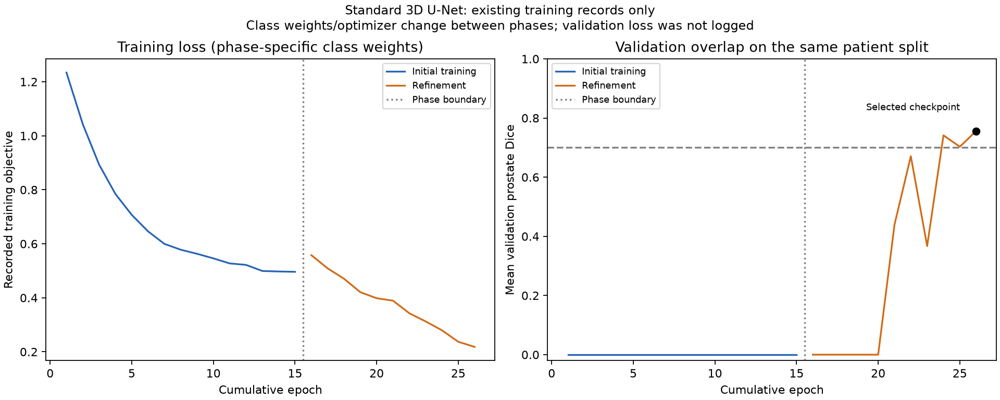
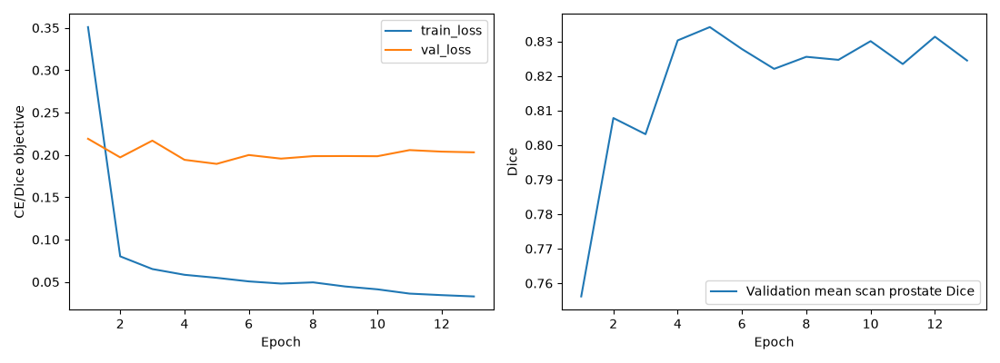
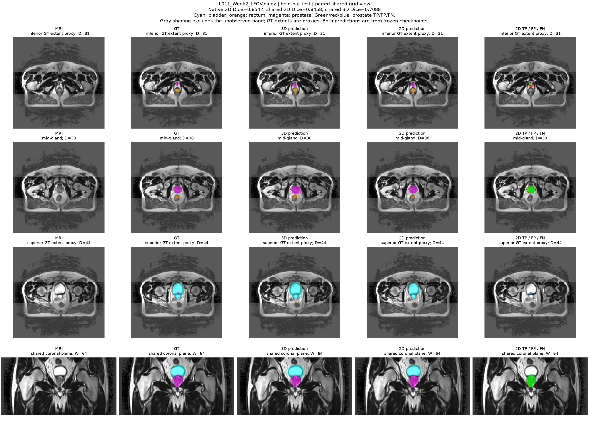
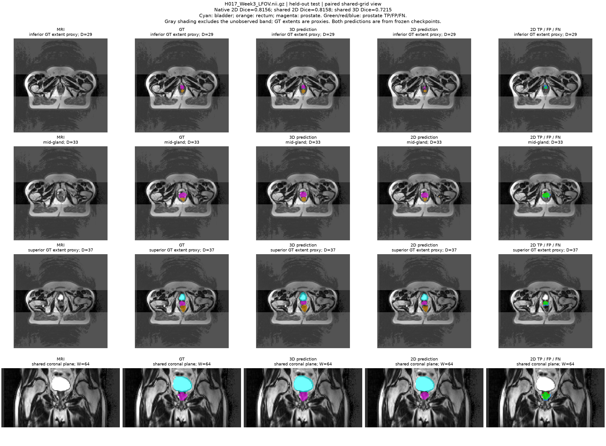
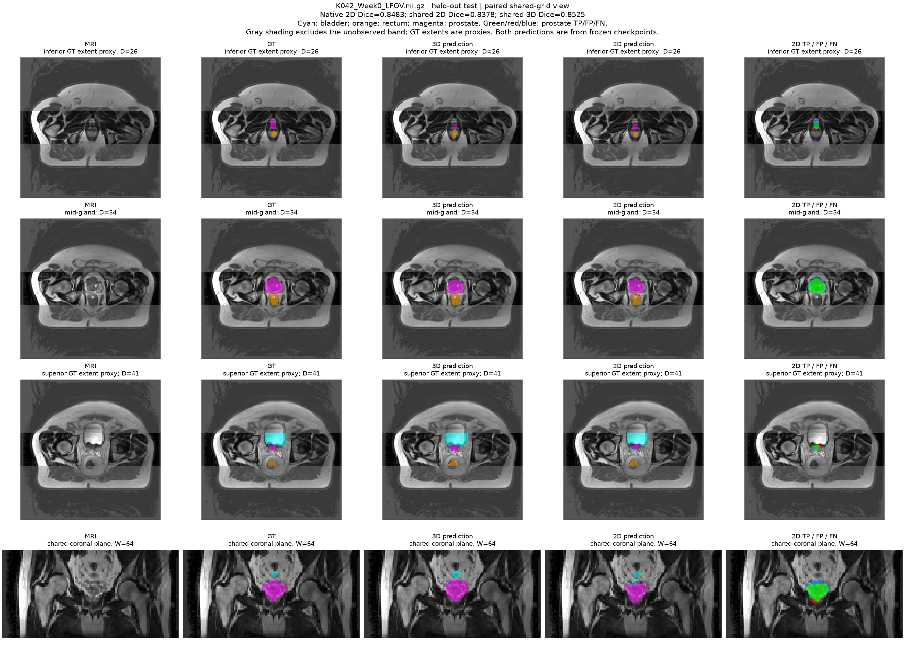

# Standard 3D U-Net (Normal difficulty)

Final held-out test prostate mean scan Dice: **0.773216** on 27 scans from six
patients. Validation-selected Dice: **0.755972**. This README is the project's
report entry point, including comparison tables and the five illustrated cases.

## Folder guide — 按实验流程阅读

```text
UNet3D_s4984160/
├── dataset.py     数据读取、划分、预处理
├── modules.py     模型结构
├── train.py       训练
├── evaluate.py    评价
├── predict.py     预测图
├── README.md      总报告
├── support/       其余辅助代码、脚本、文档、结果和历史记录
└── .gitignore     忽略数据、权重与缓存
```


上面的顺序是阅读顺序：**Dataset → Modules → Train → Evaluate → Predict**。
GitHub 文件列表默认文件夹在前、文件按字母排序，所以实际显示顺序会不同；
文件名保留课程要求。根目录只放这五个步骤、总 README 和 `.gitignore`，
其余内容统一收在 [support/](support/README.md)。本地被忽略的缓存或结果目录
不属于上面的 GitHub 文件结构。

Code is stored once. Fifteen duplicate Python copies in the three former
snapshot folders were removed after content verification. The exact submitted
versions remain available in Git, recorded by
[history/source_snapshots.json](support/history/source_snapshots.json). Remote cluster
snapshots and already submitted jobs were not changed by this reorganization.
Local-only caches/notes under `_local/` and `results/` are excluded from Git.

## Current workflow and files

| 顺序 | 主文件 | 作用 |
| --- | --- | --- |
| 1. 数据 | `dataset.py` | MRI/标签配对、患者划分、归一化与降采样 |
| 2. 模型 | `modules.py` | 标准 3D U-Net；实际归一化配置由 support 中的辅助函数构造 |
| 3. 训练 | `train.py` | 最终继续训练阶段；初始训练实现收在 support 中 |
| 4. 评价 | `evaluate.py` | 加载冻结权重，在独立测试集计算指标 |
| 5. 预测 | `predict.py` | 直接加载权重推理并出图，也可复用评价缓存 |


The model uses base width 8 and affine InstanceNorm3d (351,206 parameters),
without residual blocks or deep supervision. `modules.py` defines the standard
components; `support/baseline_model.py` constructs the normalization actually trained.
The 211 scans from 38 patients were split into 145/39/27 scans from 26/6/6
patients. MRI nonzero voxels were normalized per volume, axes changed from
(X,Y,Z) to (Z,X,Y), and MRI/labels resized to 64×128×128 using trilinear/nearest.

Training combined 15 initial epochs with 11 refinement epochs. Sampling used
50% full volumes, 25% rectum-centred and 25% prostate-centred blocks; weights
were selected using validation prostate Dice, not the test set. The refinement
stage loaded the initial last checkpoint and reset its optimizer. It stopped
after three consecutive validation scores of at least 0.70. See
[detailed methods](support/docs/methods.md) for settings and validation history.

## Running the current layout

Requires Python, PyTorch, NumPy, NiBabel, SciPy and Matplotlib. The original
evaluation environment versions are recorded in
[summary.json](support/artifacts/final_test_3d/summary.json). Private course data and
weights are not included. Dataset default:
`/home/groups/comp3710/HipMRI_Study_open`.

From this project directory on the configured cluster:

```bash
sbatch support/scripts/train_scratch.sbatch
# After initial training finishes and its last checkpoint exists:
sbatch support/scripts/train_refine.sbatch
# After the selected refinement checkpoint exists:
sbatch support/scripts/evaluate.sbatch
```

Do not submit the dependent stages concurrently. The Slurm account, partition,
GPU and 1.5-hour requests are unchanged; only Python entry-point paths changed.
These examples are for a new run, not an instruction to restart the completed
experiment. Existing evaluation requires a fresh output directory; see
[evaluation usage](support/docs/evaluation.md).

Useful local commands, from this project directory:

```bash
python -m support.training.scratch --help
python train.py --help
python -m unittest discover -s support/tests -v
python -m support.prepare_comparison
```

### Direct checkpoint prediction example

On a GPU node, from this project directory with the private course data:

```bash
python predict.py \
  --checkpoint results/refine_v2/best_model.pt \
  --mri /home/groups/comp3710/HipMRI_Study_open/semantic_MRs/B037_Week0_LFOV.nii.gz \
  --mask /home/groups/comp3710/HipMRI_Study_open/semantic_labels_only/B037_Week0_SEMANTIC.nii.gz \
  --expected-sha256 77ecc9f051d5d1213c2e62474d582050fe5b425a08182e3d2becc73540737156 \
  --device cuda --precision bf16 --threads 1 --output-dir results/direct_example
```

This loads the saved configuration/weights, applies `dataset.py` preprocessing,
runs inference, prints Dice/HD95 and saves a prediction overlay plus resized
D,H,W labels and metadata. GT is used for evaluation/visualization, not input
to the network. A new output directory is required. The original cached-render
command still works. See [prediction and resource usage](support/docs/resource_profile.md).

The final checkpoint remains on the cluster at `results/refine_v2/best_model.pt`;
its SHA256 and original metrics are in
[the result record](support/artifacts/final_test_3d/README.md). Historical early code is
under `support/history/`, not the current training entry point. Additional references:
[case analysis in Chinese](support/docs/case_analysis.md),
[comparison protocol](support/docs/comparison_protocol.md), and
[2D/3D data mapping](support/docs/data_mapping.md).

The test mean exceeds 0.70, but **3 of 27 scans fall below it**. Pooled predicted
volume exceeds GT by 17.75%. Figures and their numerical records have been
reviewed as algorithmic error examples, not an independent clinical annotation
audit. The frozen aligned 2D comparison is now complete and reported below. Code/training/evaluation
and documentation used AI assistance; retain the full disclosure in the final
report.

<!-- BEGIN GENERATED COMPARISON -->
## Model comparison: complete volume and shared band

Frozen held-out evaluation job **716656** completed. All 27 shared GT grids
matched voxel-for-voxel, and re-inferred 3D overlap counts reproduced the archive.
The 2D native task and paired shared-grid task remain separate below.
Improved 2D U-Net is optional and was not implemented or scheduled.

### A. Complete-volume 3D reference

| Scope | Patients/scans | Mean scan Dice ± SD | Mean IoU | HD95 (approx. mm) | Pooled volume ratio |
| --- | ---: | ---: | ---: | ---: | ---: |
| Standard 3D; full 64×128×128 grid | 6 / 27 | 0.7732 ± 0.0557 | 0.6336 | 6.50 | 1.1775 |

### B. Paired shared-grid prostate results

| Model | Mean scan Dice ± SD | Mean patient Dice | Mean IoU | HD95 (approx. mm) | Pooled precision / recall | Pred/GT ratio | FP in bladder / rectum |
| --- | ---: | ---: | ---: | ---: | ---: | ---: | ---: |
| Standard 3D U-Net | 0.7732 ± 0.0557 | 0.7678 | 0.6336 | 6.50 | 0.7147 / 0.8416 | 1.1775 | 89 / 21 |
| Standard 2D U-Net | 0.8232 ± 0.0645 | 0.7877 | 0.7044 | 5.18 | 0.8421 / 0.8093 | 0.9611 | 110 / 400 |
| Improved 2D (optional, not run) | — | — | — | — | — | — | — |

2D has higher Dice in **21/27 scans**; its mean scan gain is
**5.00 percentage points**. The gain falls to
**1.98 points** when weighting the six patients equally;
4/6 patients favour 2D. Multiple weeks from one patient are correlated,
so 27 scans are not 27 independent patients. These are descriptive results,
without a statistical superiority claim.

Shared scope: D=64, H=128, original full-grid W=49..78 (30 planes),
corresponding to original Y=98,100,...,156. Shared HD95 and invasion counts
were computed independently in this paired job, not copied from full-volume
3D metrics. One 2D prediction (H007 Week0) touches the cropped W boundary;
no GT or 3D prostate does. Distances refer to approximate resized spacing
and can be affected by ROI surface truncation.

### C. Six-class scope check

| Class | 3D full Dice | 3D shared Dice | 2D shared Dice |
| --- | ---: | ---: | ---: |
| Background | 0.9939 | 0.9742 | 0.9966 |
| Body | 0.9708 | 0.9663 | 0.9837 |
| Bones | 0.8748 | 0.8882 | 0.9314 |
| Bladder | 0.9146 | 0.9212 | 0.9668 |
| Rectum | 0.8197 | 0.8159 | 0.8708 |
| Prostate | 0.7732 | 0.7732 | 0.8232 |

### D. Fixed-case shared-grid comparison

| Case | 3D Dice | 2D Dice | 2D minus 3D |
| --- | ---: | ---: | ---: |
| B037_Week0 | 0.6413 | 0.7195 | +0.0782 |
| L011_Week2 | 0.7088 | 0.8458 | +0.1370 |
| H017_Week3 | 0.7215 | 0.8158 | +0.0942 |
| K042_Week0 | 0.8525 | 0.8378 | -0.0147 |
| H007_Week0 | 0.7888 | 0.6686 | -0.1202 |

The paired overlays are in the [completed 2D result record](../UNet2D_s4984160/support/artifacts/final_test_2d/README.md).
They reuse the same five cases and positions, without selecting new favourable examples.

### E. Resource profile and confounders

| Model | Parameters | Inference precision / GPU | Forward latency | Peak inference allocation |
| --- | ---: | --- | --- | --- |
| Standard 3D | 351,206 | BF16 / A100 40GB | 17.55 ms median/volume | 0.1364 GiB |
| Standard 2D | 1,942,374 | FP32 / A100 40GB | Not profiled | Not profiled |

3D latency is forward-only; the paired evaluation did not measure 2D runtime
or memory in isolation. The models were co-resident for comparison, so total
allocation would not be a valid isolated-model profile. Per-slice timing
cannot be compared with 3D per-volume timing. Precision, resolution,
normalization, width/depth, sampling and training differ. This compares the
implemented pipelines and does not isolate a causal benefit of convolution dimension.

### F. Native 2D task (all 60 unpadded slices per scan)

| Model | Patients/scans/slices | Mean scan Dice ± SD | Mean patient Dice | Mean IoU | Native-band HD95 (mm) |
| --- | ---: | ---: | ---: | ---: | ---: |
| Standard 2D | 6 / 27 / 1620 | 0.8254 ± 0.0640 | 0.7909 | 0.7075 | 4.90 |
| Improved 2D (optional, not run) | — | — | — | — | — |

The native 2D mean exceeds the 0.75 target; 4/27 scans remain below 0.75.
Native metrics use the original valid pixels and original 3D affine spacing
for the supplied partial band. They are not full-volume 3D scores and must
not be substituted into the shared-grid table.

### Interpretation

2D improves mean overlap, precision and mean HD95, with less total excess
volume. However, shared-grid rectal invasion is **400 voxels versus 21**
for 3D, and bladder invasion is 110 versus 89. 3D has higher pooled recall
(0.8416 versus 0.8093). H007 Week0 is an important 2D failure, not hidden
by the better average. Keep both models frozen; use the remaining errors
for reporting and future validation experiments, not test-set tuning.

Rules: [comparison protocol](support/docs/comparison_protocol.md).
Auditable outputs: [metrics.json](support/comparison/metrics.json),
[metrics.csv](support/comparison/metrics.csv), and
[patient_comparison.csv](support/comparison/patient_comparison.csv).
Regenerate with `python -m support.prepare_comparison` (local records only).
<!-- END GENERATED COMPARISON -->

## 3D training evidence



The plot uses the original 15 initial and 11 refinement epochs. Training
objectives have phase-specific weights, so they are plotted as separate lines.
Validation loss was not logged; the recorded validation metric is prostate
Dice. The selected point is cumulative epoch 26. Source values and hashes
are preserved in [the 3D training record](support/artifacts/training_3d/README.md).

## 2D baseline training evidence



The baseline stopped after 13 epochs without improving on epoch 5 (validation
prostate Dice 0.8341). Its held-out native score was subsequently 0.8254.
Training loss continued falling while validation performance plateaued, so
extra training was not assumed to help. The test set was not used to select
the epoch. Original training records are preserved in the
[2D training record](../UNet2D_s4984160/support/artifacts/training_716367/README.md).

## Qualitative error analysis: five held-out cases

Columns are MRI, GT, 3D prediction, 2D prediction, and 2D prostate TP/FP/FN.
Green/red/blue are TP/FP/FN; cyan/orange/magenta are bladder/rectum/prostate.
Gray shading is outside the evaluated band, not predicted background. Extent
rows are GT-based proxies, not independently annotated clinical landmarks.
Case identities and view positions were fixed from the earlier 3D review.

### B037 Week0: improved average overlap, but superior omission remains


Shared Dice rises from 0.6413 to 0.7195 and HD95 falls from 14.65 to 12.49 mm.
The 2D middle-plane core has green overlap with visible blue missed edges;
the superior D=39 GT focus remains blue/missed. Volume ratios are 0.6481 for
2D and 0.6010 for 3D: both undersegment. A better average has not repaired this
specific extent failure.

### L011 Week2: less excess prediction, residual superior error



Shared Dice improves from 0.7088 to 0.8458. The middle-plane 2D contour is less
expanded than 3D, consistent with the volume ratio falling from 1.6787 to
1.1880. HD95 improves from 8.13 to 4.71 mm; bladder invasion falls from 32 to
3 voxels. The small superior D=44 focus is still missed, so improvement is
not uniform across boundaries.

### H017 Week3: better precision with remaining undercoverage



Shared Dice improves from 0.7215 to 0.8158 and HD95 from 6.72 to 3.36 mm.
The 2D prediction is smaller overall (volume ratio 0.8130), but its precision
is higher (0.9096 versus 0.7246). Core overlap improves while blue errors
remain at small extents. Bladder invasion is zero for 2D versus ten for 3D;
rectal invasion is eight versus zero. Volume agreement alone does not rank
the models, and improved overlap does not remove every organ-confusion error.

### K042 Week0: 3D retains a small Dice advantage



Shared Dice is 0.8378 for 2D versus 0.8525 for 3D. 2D has lower recall
(0.7607 versus 0.8106) and a smaller volume ratio (0.8158 versus 0.9017),
consistent with undercoverage despite a mostly matching core. Its HD95 is
slightly lower (5.68 versus 6.26 mm), illustrating that Dice and HD95 need
not produce the same ranking.

### H007 Week0: important 2D failure and rectal confusion


Shared Dice falls from 0.7888 for 3D to 0.6686 for 2D; HD95 worsens from 4.47
to 9.06 mm. The middle-plane 2D error map has red extension toward the GT
rectal region, while blue extent misses persist. Whole shared-volume counts
confirm **191 rectal-invasion voxels for 2D versus five for 3D**; these counts
are not limited to the displayed slice. This one case supplies 47.75% of all
2D rectal-invasion voxels. It also touches the shared ROI boundary. This
failure is retained rather than hidden by the better 2D average.


The original detailed 3D-only review remains in [support/docs/case_analysis.md](support/docs/case_analysis.md). The paired review uses fixed cases and does not replace all-scan numerical evaluation.

## Final report assembly and submission status

Course specification v2.4, Sections 4, 4.1 and 5.3, requires the report in the
project-specific `README.md`, with a PDF export for Turnitin and a GitHub PR
against upstream `topic-recognition`. This file is the report entry point for
this project; the repository-root README is the shared course introduction.

This remains a report in progress. The complete method notes in
[EXPERIMENT_REPORT.md](support/docs/methods.md) should be consolidated into the
final report body, together with the original one-page feasibility review,
the completed 2D/3D comparison, literature references and a complete subsection
entitled `Artificial Intelligence Usage Disclosure`. The current root `train.py` is the final refinement training stage. The
current `predict.py` now supports direct checkpoint loading/inference and
the original cached-render mode. The GPU example is included with the
short resource measurement job; its actual completion must be checked.
A README export should
include the actual report text and figures rather than rely solely on links.
No final PDF export or PR creation is claimed by this documentation update.
